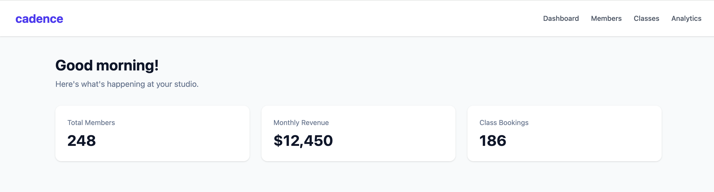
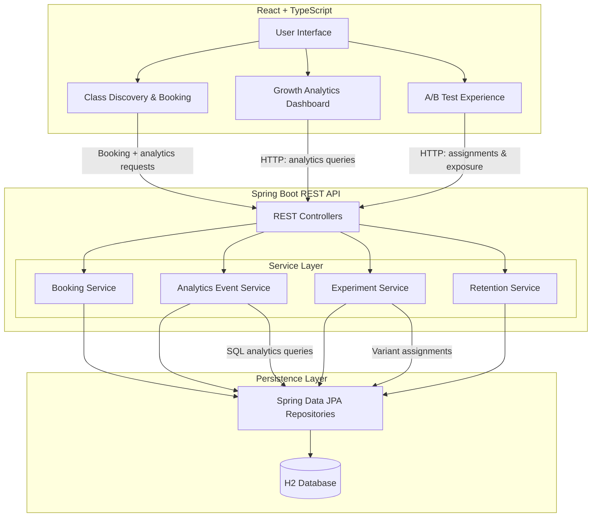

# Cadence

**A full-stack fitness studio platform exploring growth engineering through booking workflows, product analytics, and A/B experimentation.**

Cadence is a portfolio project that simulates the digital experience of a fitness studio. It combines core studio workflows with the analytics infrastructure needed to understand user behavior, measure conversion, and make data-informed product decisions.

The goal is to demonstrate how full-stack engineering can support both product functionality and business growth.

## Application Preview


## Key Features

### Membership and Class Management
- Member data management backed by a relational database.
- Class schedules with capacity limits.
- Class booking and cancellation workflows.
- Duplicate booking prevention and booking validation.

### Product Analytics
- Event tracking across the booking funnel.
- Measurement of class views, booking starts, and completed bookings.
- Conversion and abandonment rate calculations.
- Class-level performance comparisons.
- SQL-powered analytics queries.

### A/B Experimentation
- Experiment creation and activation.
- Persistent member-level variant assignments.
- Control and test experiences for booking button copy.
- Exposure event tracking.
- Conversion comparisons across experiment variants.
- Sample-size visibility to provide context when interpreting results.

## Technology Stack

| Layer | Technologies |
|---|---|
| Frontend | React, TypeScript |
| Backend | Java, Spring Boot |
| Data | Spring Data JPA, H2, SQL |
| Testing | JUnit, Mockito |
| Build Tools | Maven, npm |

## Architecture

The application follows a layered architecture. The React frontend communicates with the Spring Boot REST API, which coordinates business logic, persistence, analytics tracking, and experimentation.



### Key Data Flows

1. **Booking:** Members browse classes and book sessions. The backend validates booking rules and persists booking records.
2. **Analytics:** Frontend interactions generate events that are sent to the backend and stored for reporting.
3. **Experimentation:** The backend assigns members to persistent experiment variants. Exposure and conversion events are used to compare results.
4. **Growth reporting:** SQL queries aggregate behavioral events into booking funnel, class performance, and experiment conversion metrics.


## Engineering Focus

This project explores several concepts relevant to growth engineering:

- **Funnel analysis:** Understanding where users progress or abandon a booking workflow.
- **Event instrumentation:** Capturing behavioral data throughout the user journey.
- **Experimentation:** Assigning users to consistent variants and measuring conversion.
- **Data-driven decisions:** Using SQL and reporting to identify opportunities for product improvement.
- **Full-stack ownership:** Building features across the frontend, backend, and data layers.

## Current Project Status

**Implemented:**

- Member and class persistence.
- Booking and cancellation workflows, including duplicate booking prevention and capacity validation.
- Analytics event tracking and booking funnel reporting.
- Class-level conversion comparisons.
- A/B experiment creation, activation, and persistent member-level variant assignment.
- Experiment exposure tracking and conversion reporting.
- Retention insights, including repeat booking rates, returning and one-time bookers, inactive members, never-booked members, and cancelled-only members.
- Class-level repeat booking analysis.
- Backend unit tests and frontend production build validation.
- Centralized API exception handling and frontend error states.

**Future improvements:**

- Authentication and user-specific authorization.
- More precise behavioral event instrumentation.
- Production database integration and deployment.
- Expanded checkout and lifecycle messaging workflows.

## Project Limitations

Cadence is a portfolio project and demonstration environment, not a production fitness booking platform.

Current implementation considerations:

- The development environment uses an in-memory H2 database, so application data resets when the backend restarts.
- Member IDs currently stand in for authenticated user identity.
- Class-view and experiment-exposure events are recorded when the class list loads, rather than based on verified viewport visibility.
- Retention metrics measure booking behavior, not actual class attendance.
- Production deployment has been deferred.


## Running Locally

The project is organized as a Spring Boot backend with a React frontend in `cadence-web`.

**Backend**
```bash
./mvnw spring-boot:run
```

Backend: `http://localhost:8080`

Health check: `http://localhost:8080/api/health`

**Frontend**
```bash
cd cadence-web
npm install
npm run dev
```

Frontend: `http://localhost:5173`

**Backend tests**
```bash
./mvnw test
```

**Frontend production build**
```bash
cd cadence-web
npm run build
```

## Project Context

Cadence is an independently developed portfolio project designed to demonstrate practical full-stack engineering, analytics instrumentation, and experimentation concepts.

It is a learning and demonstration environment, not a production fitness booking platform. The current development environment uses an in-memory H2 database, so application data resets when the backend restarts.

